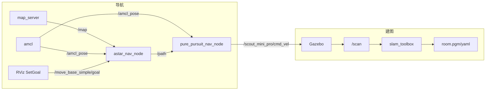

# 基于 ROS 的越野环境生态友好型自动驾驶系统：当前实现进度

## 摘要

本文档记录申报项目「基于ROS的越野环境生态友好型自动驾驶系统」的当前开发进度。项目响应大赛主题「锻造未来交通之力：以高阶人才培养擎动智能转型与绿色发展」，旨在搭建一套基于 ROS 的自主导航系统，在非结构化越野环境下实现合理路径规划，并预留语义分割与目标识别接口，以降低对自然结构与动植物的影响。当前阶段已完成机器人模型构建、Gazebo 仿真、slam_toolbox 建图以及基于 A* 与 Pure Pursuit 的简单自主导航；语义分割与目标识别尚未实现。

**关键词**：ROS；自主导航；越野环境；A* 路径规划；Pure Pursuit；Scout Mini Pro；Gazebo；slam_toolbox；AMCL

---

## 1. 引言与研究背景

### 1.1 大赛主题与项目定位

大赛主题为「锻造未来交通之力：以高阶人才培养擎动智能转型与绿色发展」。团队申报项目名称为**「基于ROS的越野环境生态友好型自动驾驶系统」**，目标是在非结构化越野场景下实现基于 ROS 的自动驾驶（自主导航）系统，并具备简单的语义分割与目标识别能力，以避免对越野环境中的特殊自然结构和动植物（如树木、大型植物等）造成破坏，同时实现合理的路径规划。

### 1.2 当前阶段

截至目前，系统已完成以下工作：

- **机器人模型构建**：基于 xacro 的 Scout Mini Pro 整车模型（车身、四轮差速、D435 相机、RS-Helios-16P 激光雷达等），并在 Gazebo 中完成仿真配置。
- **简单导航实现**：基于已有地图的定位（AMCL）、A* 全局路径规划与 Pure Pursuit 轨迹跟踪，在室内 room 仿真场景下实现「设目标点 → 自动行驶」的闭环。

语义分割与目标识别模块尚未开发，越野专用场景与生态约束下的路径决策为后续工作内容。

---

## 2. 系统架构概览

### 2.1 整体数据流

系统分为**建图**与**导航**两大部分：建图阶段在 Gazebo 仿真环境中驱动机器人运动，由激光雷达提供 `/scan`，slam_toolbox 在线构建地图并保存为 `room.pgm` / `room.yaml`；导航阶段加载该地图，通过 map_server 发布 `/map`，AMCL 提供定位，用户在 RViz 中通过 SetGoal 发布目标到 `/move_base_simple/goal`，A* 节点规划全局路径并发布 `/path`，Pure Pursuit 节点跟踪路径并发布 `/scout_mini_pro/cmd_vel` 控制机器人。

### 2.2 与 move_base 的差异

本系统**未使用 ROS 标准导航栈 move_base**，而是采用 **A* 全局路径 + Pure Pursuit 轨迹跟踪** 的轻量方案：全局规划与轨迹跟踪逻辑清晰、便于教学与二次开发，且不依赖 costmap 与 base_local_planner 的复杂参数。`config/nav/` 下保留的 global_costmap、local_costmap、base_local_planner 等配置文件为历史参考，当前导航栈不再使用。

---

## 3. 机器人平台与仿真环境

### 3.1 机器人模型

- **主文件**：`scout_mini_pro_description/xacro/main/scout_mini_pro.xacro`，由各 launch 通过 xacro 解析为 `robot_description` 并加载。
- **子模块**：
  - 宏：`common_macros.xacro`、`gazebo_diff_drive.xacro`、`gazebo_sensor_plugin.xacro`
  - 执行器：`actuator/wheel.xacro`（四轮）
  - 传感器：`sensor/camera_d435.xacro`、`sensor/laser_helios.xacro`、`sensor/imu_ch110.xacro`
- **主要 link 与关节**：
  - `base_footprint`（虚拟，z=0.01 m）→ `base_link`（车身 0.6×0.4×0.2 m，质量 5 kg）
  - 四轮：`front_left/right`、`rear_left/right`；后两轮为差速驱动关节（`rear_left_wheel_joint`、`rear_right_wheel_joint`）
  - 传感器 link：`camera_link`（D435）、`laser_link`（RS-Helios-16P）、`imu_link`（CH110，Gazebo IMU 插件已在 xacro 中注释，未启用）
- **差速驱动**：由 `gazebo_diff_drive` 宏配置，命名空间 `/scout_mini_pro`，控制话题 `cmd_vel`，里程计话题 `odom`，机器人基坐标系 `base_footprint`，更新率 50 Hz，并发布 odom → base_footprint 的 TF。

### 3.2 传感器与话题

| 传感器       | 话题（命名空间 /scout_mini_pro） | 说明 |
| ------------|----------------------------------|------|
| 激光雷达     | `/scout_mini_pro/scan`           | 可 remap 为全局 `/scan` 供 AMCL、slam_toolbox 使用 |
| RGB 相机    | `/scout_mini_pro/image_raw`、`camera_info` | 由 libgazebo_ros_camera 发布 |
| 深度相机    | `/scout_mini_pro/depth/image_raw`、`camera_info`、`points` | 挂在 camera_link，与 RGB 并存 |
| IMU         | 未启用                           | xacro 中 gazebo_imu_plugin 已注释 |

### 3.3 仿真与 Launch 分工

- **Gazebo**：版本 11.15；场景为室内 room。
- **Launch 文件**：
  - `gazebo_room.launch`：仅启动 Gazebo 与机器人。
  - `gazebo_room_slam.launch`：Gazebo + slam_toolbox 在线建图 + RViz（SLAM 用）；用于建图阶段。
  - `nav_bringup.launch`：map_server（加载 `maps/room.yaml`）+ A* 节点 + Pure Pursuit 节点；用于导航阶段（需已启动 Gazebo 与 AMCL）。
  - 其他：`gazebo_room_rviz.launch`、`display_rviz.launch`、`gazebo_sim.launch` 等，用于仿真与可视化。

---

## 4. 建图与定位

### 4.1 建图

- **算法与工具**：slam_toolbox 在线异步建图，订阅激光 `/scan` 与里程计（及 TF），发布 `/map` 与 map 坐标系下的 TF。
- **流程**：使用 `gazebo_room_slam.launch` 一键启动 Gazebo、slam_toolbox 与 RViz；驱动机器人在场景中运动完成建图后，使用 map_saver 将地图保存为 `scout_mini_pro_description/maps/room.pgm` 与 `room.yaml`。详细步骤见包内 README_2 第六节与 README_3。
- **导航前提**：导航阶段需已存在 `maps/room.yaml` 与 `room.pgm`，由 map_server 加载并发布 `/map`。

### 4.2 定位

- **算法**：AMCL（Adaptive Monte Carlo Localization）。
- **话题与 TF**：AMCL 订阅 `/map`、`/scan`、`/initialpose`（RViz SetInitialPose），发布 `map` → `odom` 的 TF 及 `/amcl_pose`。启动 AMCL 时需将里程计 remap 为 `odom:=/scout_mini_pro/odom`。
- **帧关系**：`map` → `odom`（AMCL）→ `scout_mini_pro/odom`（Gazebo 差速）→ `scout_mini_pro/base_footprint`；通过 static 变换与 base_footprint 对接，形成完整 TF 链。

---

## 5. 路径规划与轨迹跟踪

### 5.1 A* 全局路径规划

- **实现文件**：`scout_mini_pro_description/scripts/astar_nav_node.py`（自 ROS2 参考项目 Pure-tracking-slam-automatic-navigation-system 移植至 ROS Noetic）。
- **订阅**：`/map`（OccupancyGrid）、`/amcl_pose`（PoseWithCovarianceStamped）、`/move_base_simple/goal`（PoseStamped，通过 launch 中 remap 与 RViz SetGoal 一致）。
- **发布**：`/path`（nav_msgs/Path，frame_id=map）。
- **逻辑概要**：
  1. **代价栅格**：对 `/map` 的 data 做栅格膨胀（默认 3 格，约 0.15 m @ 0.05 m 分辨率），避免路径贴墙；膨胀半径可通过 rosparam `~expansion_size` 调节（如 2 更易出路径，4 更保守）。起点、终点及其目标周围 3×3 置为可通行，避免目标点被膨胀堵死。
  2. **A* 搜索**：在膨胀后的栅格上做 8 邻域 A*，启发式为欧氏距离；栅格值 100 视为障碍，其余为可通行（含未知 -1 经缩放后参与代价）。
  3. **路径平滑**：将得到的离散路径点用 scipy 的 B-Spline 进行贝塞尔平滑，采样点数取 max(30, 路径点数)。
  4. **定时更新**：0.1 s 定时器根据当前 AMCL 位姿与目标点重新规划；若与目标距离 ≤ 0.2 m 则清空路径并停止发布。
- **参数**：`~expansion_size`（默认 3）、`~goal_topic`（默认 `goal`，launch 中 remap 为 `/move_base_simple/goal`）。

### 5.2 Pure Pursuit 轨迹跟踪

- **实现文件**：`scout_mini_pro_description/scripts/pure_pursuit_nav_node.py`（同上，自 ROS2 移植）。
- **订阅**：`/path`（Path）、`/amcl_pose`（PoseWithCovarianceStamped）。
- **发布**：`/scout_mini_pro/cmd_vel`（Twist）。
- **逻辑概要**：
  1. **路径插值**：收到 `/path` 后按 segment_length=0.1 m 对路径点线性插值，得到更密的轨迹点，便于前视距离选取。
  2. **最近点与前视点**：用 scipy.spatial.KDTree 在路径上找与当前位姿最近的点，再沿路径向前选取第一个与前视距离（默认 0.3 m，rosparam `~lookahead_distance`）≥ 的目标点。
  3. **转向角与线速度**：根据当前航向与前视目标点计算目标航向角，转向角 = 目标航向 - 当前航向（归一化到 ±π）；线速度采用与转向角相关的规则（如 base 1.5 m/s、大转角时限速 0.5 m/s），角速度直接为转向角。
  4. **到达判定**：当前位姿与路径终点距离 < 0.2 m 时发布零速度并清除路径接收状态。
  5. **控制频率**：20 Hz 定时器发布 cmd_vel。
- **参数**：`~lookahead_distance`（默认 0.3）。

### 5.3 导航话题与帧汇总

| 用途   | 话题/帧                       | 说明 |
|--------|-------------------------------|------|
| 激光   | `/scan`                       | 激光需发布到全局 `/scan`（或 remap） |
| 里程计 | `/scout_mini_pro/odom`        | AMCL 需 remap：`odom:=/scout_mini_pro/odom` |
| 控制   | `/scout_mini_pro/cmd_vel`     | Pure Pursuit 直接发布 |
| 地图   | `/map`                        | map_server 发布 |
| 初始位姿 | `/initialpose`              | AMCL 订阅，RViz SetInitialPose |
| 导航目标 | `/move_base_simple/goal`   | RViz SetGoal，A* 订阅（launch 中 remap） |
| 路径   | `/path`                       | A* 发布，Pure Pursuit 订阅 |

---

## 6. 依赖与环境

### 6.1 ROS 与包依赖

- **ROS 版本**：Noetic（建议运行环境 Ubuntu 20.04）。
- **核心包依赖**（见 `scout_mini_pro_description/package.xml`）：
  - 构建/运行：catkin、gazebo_ros、gazebo_ros_control、joint_state_publisher、robot_state_publisher、urdf、xacro
  - 运行：gazebo_msgs、rviz、map_server、nav_msgs、geometry_msgs、amcl
- **建图**：slam_toolbox（需单独安装，如 `sudo apt install ros-noetic-slam-toolbox`）。
- **导航**：amcl、map_server（如 `sudo apt install ros-noetic-amcl ros-noetic-map-server`）。本方案不依赖 `ros-noetic-navigation`（move_base）。

### 6.2 Python 与系统依赖

- A* 与 Pure Pursuit 节点依赖 **numpy**、**scipy**（B-Spline 平滑、KDTree）。可安装：`sudo apt install python3-scipy python3-numpy`。

### 6.3 编译与运行顺序

- 编译：`cd ~/catkin_ws_2`，`source /opt/ros/noetic/setup.bash`，`catkin_make`，`source devel/setup.bash`。若 `src` 下含 ROS2（ament）包，需使用 `catkin_make_isolated` 或将 ROS2 包移出后再编译。
- 导航前每个终端需执行：`cd ~/catkin_ws_2`，`source devel/setup.bash`。
- 仿真时间：先执行 `rosparam set use_sim_time true`。
- 导航启动顺序（概要）：(1) Gazebo（如 `gazebo_room.launch`）；(2) `nav_bringup.launch`（先发布 `/map`）；(3) 加载 AMCL 参数并启动 amcl（odom remap）；(4) RViz；SetInitialPose 后 SetGoal 即可开始导航。详见 `scout_mini_pro_description/README_3.md` 第六节。

---

## 7. 当前未实现部分与后续工作

### 7.1 语义分割与目标识别

- **现状**：代码库中未实现语义分割或目标识别节点，无相关话题或服务。
- **后续计划**：可基于 D435 的 RGB/深度与点云数据，接入语义分割或目标检测模型（如植被、树木、大型障碍物），将结果以代价或语义层形式反馈给路径规划，实现「生态友好」的避障与路径选择。

### 7.2 越野场景与生态友好策略

- **现状**：当前仿真与地图均为室内 room 场景；路径规划仅基于二维占据栅格与几何避障（膨胀），未引入生态或语义约束。
- **后续工作**：迁移到越野仿真或实车环境；结合语义信息对特殊区域（如植被、水体）施加约束或代价，使路径规划更符合「生态友好」目标。

---

## 参考文献与参考资料

- 本包：`scout_mini_pro_description/README_2.md`（建图与地图保存）、`scout_mini_pro_description/README_3.md`（导航操作与话题说明）。
- 参考实现：Pure-tracking-slam-automatic-navigation-system（ROS2 版本 A* 与 Pure Pursuit 逻辑已移植至本包 scripts）。
- ROS 官方：amcl、map_server、slam_toolbox 文档与 wiki。
